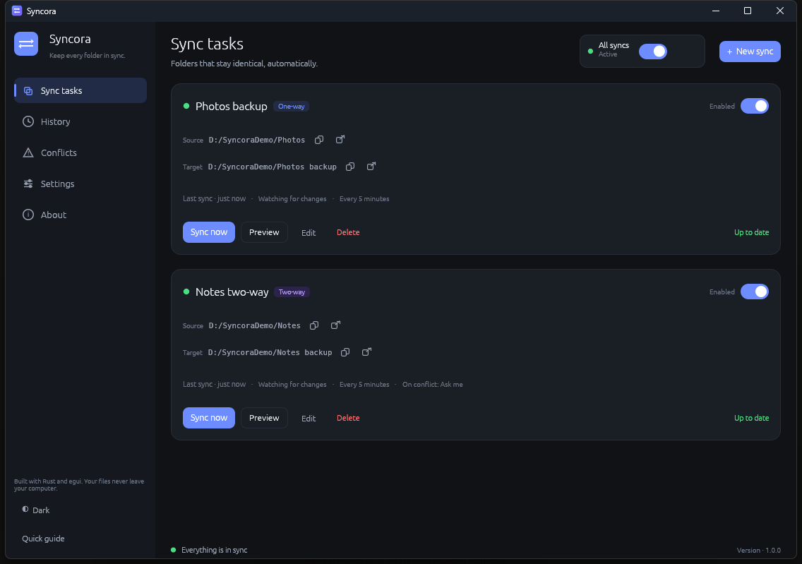

# Syncora

**Keep two or more folders identical — automatically, in the background.**

Syncora is a small, fast Windows desktop app that watches your folders and keeps them
in sync. Add a task, pick two folders and a mode, and forget about it: changes are
detected within seconds, copied incrementally, and conflicts are surfaced instead of
silently overwriting your work.

Built entirely with **Rust** and **egui**. Ships as a single portable `.exe` — no
installer, no account, no admin rights, no telemetry.



---

## Features

### Sync modes

| Mode | What it does | Typical use |
| --- | --- | --- |
| **One-way** | Copies new and changed files from source to target. Nothing is ever deleted on the target. | Simple backups |
| **Two-way** | Changes on either side propagate to the other side. | Keeping a laptop and a desktop folder in step |
| **Mirror** | Makes the target an exact copy of the source, including deletions. | Publishing, device copies, USB drives |

All modes are **incremental**: only new or modified files are transferred, so a sync of
a large folder with a few edits finishes in milliseconds.

### Conflict handling

When the same file changes on both sides, Syncora does not guess. It:

- records the conflict and shows a badge in the sidebar,
- sends a **Windows toast notification**,
- lets you resolve it with **Keep source**, **Keep target** or **Keep both**
  (the newer version keeps the original name, the older one is renamed with a
  `(conflict <date>)` suffix so nothing is lost),
- or applies an automatic rule you configure: *Ask*, *Keep both*, *Prefer source*,
  *Prefer target* or *Skip*.

### Background operation

- Runs from the **system tray**; closing the window keeps the app running.
- Each task syncs on its own schedule and, optionally, **in real time** via filesystem
  watching with a short debounce.
- A **master switch** pauses every task at once (also available from the tray menu).

### Interface

- Guided first-run screen and tooltips on every non-obvious control.
- **English and Chinese**, chosen from the system language on first launch and
  switchable in Settings.
- Follows the Windows **light/dark** theme, with a manual override.
- **Sync history** with per-run file counts, bytes, duration and result.
- **Preview** any task before it runs: see exactly what would be copied, updated,
  deleted or flagged as a conflict.
- Export and import settings as a single JSON file.

### Extras

- **Start with Windows** (off by default, stored per user in `HKCU`, never needs admin).
- **Checksum verification** — re-reads each copy and compares a BLAKE3 hash.
- **Exclude patterns** per task (glob syntax, e.g. `*.tmp`, `node_modules/**`).
- **Skip hidden and system files** toggle.
- **Per-task conflict policy** that overrides the global default.
- **Path validation** — refuses source/target pairs that are identical, nested, or
  missing, before anything is touched.
- **Live progress** with a cancel button, plus copy-path and open-folder shortcuts on
  every task card.
- **Log file** with automatic rotation, reachable from Settings.

---

## Install

### Download

Grab `Syncora.exe` from the
[Releases page](https://github.com/ChathamHung/Syncora/releases) and run it. It is a
single portable executable — nothing to install, no dependencies, no admin prompt.

### Build from source

Requires a recent stable Rust toolchain and the MSVC build tools.

```bash
git clone https://github.com/ChathamHung/Syncora.git
cd Syncora
cargo build --release
```

The executable is written to `target/release/Syncora.exe`.

Run the test suite (sync engine and configuration):

```bash
cargo test
```

---

## How it works

Syncora keeps a small snapshot of every task — the relative path, size, modification
time and BLAKE3 hash of each file at the end of the last successful sync. A sync run
scans both sides and compares them against that snapshot, which is enough to tell
*"this file is new"* from *"this file was deleted"* and to recognise a genuine
two-sided edit as a conflict rather than a deletion.

Copies are atomic: data is written to a temporary file, the original modification time
is restored, and the file is renamed into place, so an interrupted sync never leaves a
half-written file behind.

### Where things are stored

| Path | Contents |
| --- | --- |
| `%APPDATA%\Syncora\config.json` | Tasks and settings |
| `%APPDATA%\Syncora\history.json` | Sync history |
| `%APPDATA%\Syncora\conflicts.json` | Unresolved conflicts |
| `%APPDATA%\Syncora\snapshots\` | Per-task last-synced snapshots |
| `%APPDATA%\Syncora\syncora.log` | Diagnostic log (rotated at 2 MB) |

Everything is plain JSON, so the configuration is easy to inspect, back up or version.

---

## Project layout

```
src/
  main.rs      Entry point, window setup, single-instance guard
  app.rs       All UI: pages, task cards, modals, toasts
  engine.rs    Background worker thread: scheduling, watchers, job queue
  sync.rs      Sync engine: scanning, planning, executing (UI-free and unit tested)
  config.rs    Settings, tasks and persistence
  theme.rs     Colour palette and egui styling
  i18n.rs      English / Chinese strings
  platform.rs  Windows integration: autostart, toasts, tray, DPI, mutex
  tray.rs      Tray icon and menu
  util.rs      Logging, formatting and file helpers
```

The sync engine in `sync.rs` has no UI dependencies, which is why the planning and
conflict logic can be tested without a window.

## Tech stack

[egui](https://github.com/emilk/egui) / [eframe](https://github.com/emilk/egui) for the
GUI, [`notify`](https://crates.io/crates/notify) for filesystem watching,
[`blake3`](https://crates.io/crates/blake3) for hashing,
[`tray-icon`](https://crates.io/crates/tray-icon) for the tray icon and
[`tauri-winrt-notification`](https://crates.io/crates/tauri-winrt-notification) for
Windows toasts.

---

## AI Used
The entire project was created using DeepSeek V4.1 Flash (Max). Only the final publishing step was performed by a human.

<details>
  <summary>Original Prompts</summary>

  ### English Version (translated)
  ```
  Develop a file and folder synchronization application using the Rust programming language and the `egui` (https://github.com/emilk/egui) framework. You may choose any name for the software.
The purpose of the software is to keep the contents of two or more files or folders synchronized. When a file or folder is added, modified, or deleted in one location, the software should automatically propagate these changes to the designated target locations, ensuring that the content remains identical across all devices or storage spaces. The application should support multiple synchronization tasks.
Core features must include:
- One-way Sync: Data is copied in one direction—from the "source" to the "destination" (typically used for backups).
- Two-way (Bi-directional) Sync: Changes made to files on either device (A or B) are reflected on the other, ensuring consistency.
- Mirror Sync: The destination folder is forced to become an exact replica of the source folder (files deleted from the source are also removed from the destination).
- Incremental/Differential Sync: The software detects and transfers only files that have been modified or newly added, saving significant time and storage space.

The software should:
- Feature an intuitive, user-friendly interface.
- Be ready to use "out of the box" (requiring minimal initial configuration).
- Include UI elements (such as tooltips) to help users understand how to use the software.
- Support background operation (including the ability to minimize to the system tray).
- Include a settings page.
- Support automatic startup on system boot (disabled by default; configurable via settings).
- Handle conflicts by issuing Windows notifications, allowing users to choose how to resolve them—or alternatively, providing an option in the settings to automate conflict resolution. •	Synchronize history records.
- Support switching between English, Chinese, and other languages ​​(for now, please implement English and Chinese; the application should detect the system language upon startup).
- Automatically switch between light and dark themes based on system settings (allow users to manually override this in the settings).
- Enable users to export and import configuration files.
- Include a master switch to enable or disable all tasks.
All code comments must be in English and written to be easily readable and maintainable by others. Ensure the project is free of errors and that all features function correctly. Every task must be designed to run automatically in the background.

These are the core requirements; you are welcome to add extra features (please provide a description of any additional features you implement). Use the `egui` library to build the application's GUI. Please create a brand-new project—do not use or modify any existing, older projects. Ensure that none of the required features necessitate administrator privileges (if a folder requires such permissions, prompt the user accordingly). The final build should be a single, portable executable (EXE) file. The software must be error-free and fully functional; the terminal window should not appear while the application is running. Upon completion, please compile the project using `cargo build --release`.
  ```

  ### Original Prompt (Chinese)
  ```
用Rust语言和egui (https://github.com/emilk/egui) 制作一个文件和资料夹同步软件（File and folder sync software）。名字你自己随便起。
软件的目的是保持两个或多个文件和资料夹里面的内容保持相同，如果检测在其中一个地方新增、修改或删除时，软体需要自动把这些变更复制或传播到指定的位置，确保所有装置或储存空间上的内容完全相同。允许用户可以添加多个同步任务而不只是一个。
需要包含的核心功能：
- 单向同步（One-way Sync）：资料只会从「来源端」单向复制到「目标端」（常用于建立备份）。
- 双向同步（Two-way / Bi-directional Sync）：无论你在 A 装置还是 B 装置修改了档案，两边都会互相更新，保持内容一致。
- 镜像同步（Mirror Sync）：将目标资料夹强制变成与来源资料夹一模一样（来源端删除的档案，目标端也会跟着删除）。
- 增量/差异同步：软体只会侦测并传输「被修改过或新增加」的档案，省下大量的传输时间与储存空间。

软件需要：
- 制作一个良好可以让用户简单上手的界面
- 确保可以开箱即用（不需要过多的基本设置）
- 添加一些组件让用户了解和如何使用（例如tooltip）
- 确保软件可以在背景运行（需要允许收缩到托盘里面）
- 包括设置页面
- 开机自启（默认关闭，用户需要在设置里面开启）
- 如果检测到冲突，可以使用Windows的通知提醒，允许用户选择如何解决，或者用户可以在设置中调整自动处理。
- 同步历史纪录
- 英文，中文和其他的语言切换（你目前只需要做英文和中文的语言就行了。默认打开的时候需要检测系统的语言）
- 需要根据系统的检测浅色和深色主题中切换（允许用户在设置中手动更改）
- 允许用户导出或导入设置文件
- 一个总开关可以控制全部任务的开启或关闭

在代码中所有的注释需要用英文，并让其他人可以简单易读和修改。还有确保整个项目不会有任何错误，并且所有功能可以正常运行。每个任务需要确保能在背景自动完成运行。
以上这些是软件的基本要求，你可以自己添加一些额外的功能（完成的时候，你需要描述出来你加了什么功能）。你需要使用egui library创建整个应用的GUI。请创建一个全新的项目，请勿使用或修改以前的旧项目。并且确保以上的所有功能都不需要管理员权限（如果文件夹需要管理员的权限的时候，可以向用户申请）。编译出来的需要是单个携带版EXE文件。确保软件不会出现任何错误并且所有功能需要运作并且正常，还有不要出现终端在运行的时候。完成的时候请运行`cargo build --release`进行编译。
  ```
  
</details>

---

## 中文简介

**Syncora 是一款让多个文件夹始终保持一致的 Windows 同步工具**，使用 Rust 与 egui
编写，单文件绿色运行，无需安装、无需账号、无需管理员权限。

**三种同步模式**

- **单向同步**：只从来源复制到目标，目标端永不删除，适合做备份。
- **双向同步**：两侧改动互相传播，适合多台设备之间保持一致。
- **镜像同步**：让目标与来源完全相同，来源端删除的文件在目标端也会被删除。

所有模式都是**增量同步**，只传输新增或修改过的文件。

**冲突处理**：同一文件两侧都被修改时不会擅自覆盖。程序会在侧边栏标记、弹出 Windows
通知，由你选择「保留来源」「保留目标」或「两者都保留」（较旧的版本会加上冲突后缀），
也可以在设置中指定自动规则。

**其他特性**：实时文件监视与定时检查、总开关、同步历史、执行前预览、排除规则、
BLAKE3 校验、开机自启（默认关闭）、托盘常驻、中英文界面、跟随系统深/浅色主题、
设置导入导出。

**自行编译**

```bash
git clone https://github.com/ChathamHung/Syncora.git
cd Syncora
cargo build --release
```

生成的 `target/release/Syncora.exe` 即为可直接运行的单文件程序。

---

## License

[MIT](LICENSE) © 2026 ChathamHung

Free to use, modify and redistribute — including commercially — as long as the
copyright notice and permission notice are kept.

本项目采用 [MIT 许可证](LICENSE)，可自由使用、修改与再分发（含商业用途），
只需保留版权声明与许可声明。

